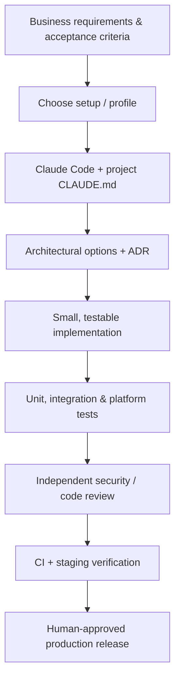

<div align="center">

# AI Engineering Setups

### From requirements to production-ready software — with reusable AI engineering playbooks.

**Claude Code · .NET / C# · Clean Architecture · Blazor · .NET MAUI · iOS · Android · Windows · macOS**

[Get started](#quick-start) · [Available setups](#available-setups) · [MAUI guide](overlays/maui-cross-platform/README.md) · [Engineering principles](#engineering-principles) · [Contribute](CONTRIBUTING.md)

</div>

---

## Why this repository exists

AI can generate code quickly. Shipping software requires more: understanding business constraints, choosing sensible architecture, handling failure modes, reviewing changes, proving behavior with tests, and delivering safely.

**AI Engineering Setups** is a versioned collection of **instructions, skills, agents, templates, checklists, and reference material** for AI-assisted software teams. Each setup is designed to be *adopted by an existing codebase*, not to impose a giant framework.

> **Guiding principle:** Prefer the simplest maintainable solution that meets the actual requirements. Use **KISS · DRY · YAGNI**. Make architecture decisions explicit, measure performance, and never report unexecuted checks as passing.

### What you get

| Capability | How it helps |
| --- | --- |
| **Engineering contract** | Concise project rules in `CLAUDE.md`, including quality, security, and delivery guardrails. |
| **On-demand skills** | Repeatable workflows for requirements, architecture, features, reviews, testing, deployment and release. |
| **Specialist agents** | Focused roles for architecture, .NET, UI, MAUI, security, QA and operations. |
| **Path-scoped rules** | Technology conventions loaded only when relevant files are in scope. |
| **Traceable knowledge** | Original summaries of patterns and public documentation, with source links. |
| **Safe installation** | Preview changes first; the installer never overwrites existing files without an explicit flag. |

## Available setups

| Preset | Focus | Status |
| --- | --- | --- |
| **[`dotnet`](setups/dotnet/)** | ASP.NET Core, C#, EF Core, DDD/CQRS choices, Clean/Vertical Slice approaches, Razor, Blazor, DevOps, testing and reviews. | Included |
| **[`dotnet-maui`](overlays/maui-cross-platform/)** | All of `dotnet`, plus native MAUI XAML/MVVM, iOS, Android, macOS (Mac Catalyst), Windows (WinUI), Blazor Hybrid, offline sync, signing, tests and store releases. | Included |
| `devops-homelab` | Ansible, Jenkins, Docker, source control, secure deployment, monitoring. | Planned; not included |
| `autonomous-delivery` | GitHub Projects orchestration, isolated workers, PR/CI gates, resumable issue processing. | Planned; not included |

### How the pieces fit together



This is a **toolkit**, not an autonomous orchestrator. These files do not automatically open GitHub issues, approve PRs, run store releases or run Claude 24/7.

## Quick start

**Requirements:** Python 3.10+ for the optional installer; Claude Code installed separately; the SDKs/toolchains used by your target project. Installing a setup does *not* install .NET, Xcode or Android SDK.

Clone this repository:

```bash
git clone https://github.com/vpetukhov-wbss/ai-engineering-setups.git
cd ai-engineering-setups
```

The URL becomes available **after the public repository is created and pushed**. If you downloaded the ZIP instead, open the extracted folder.

**Preview** a .NET setup installation into an existing application:

```bash
python3 scripts/install.py --preset dotnet --target /path/to/your-project
```

**Preview** the full .NET + MAUI profile:

```bash
python3 scripts/install.py --preset dotnet-maui --target /path/to/your-project
```

**Apply** only after reviewing the plan:

```bash
python3 scripts/install.py --preset dotnet-maui --target /path/to/your-project --apply
```

The installer will **skip conflicting files** by default. It will **not** replace your existing `CLAUDE.md`, `.claude/settings.json`, or any other existing file. Inspect conflicts and merge them manually. A deliberately explicit `--overwrite` exists for disposable test repositories only; **back up and review your changes first**.

Then, from your application repository:

```bash
claude
# In Claude Code:
# /requirements-to-solution <your business requirements>
# /maui-app-architecture <cross-platform application brief>
# /maui-feature <feature requirements>
# /maui-device-test <feature or release scope>
```

If your project already has a `CLAUDE.md`, copy the relevant guidance from [`MAUI_CLAUDE_APPEND.md`](overlays/maui-cross-platform/MAUI_CLAUDE_APPEND.md) into it. This is **not automatically appended**, to preserve ownership of your existing instructions.

### Global vs. per-project

Prefer **per-project installs**. Keep the reusable upstream content here, and customize a copy inside each application repository. Avoid setting product-specific assumptions globally across unrelated projects.

## Repository map

```text
ai-engineering-setups/
├── README.md                     # Project overview and installation
├── LICENSE                       # MIT license for original repository material
├── CONTRIBUTING.md               # Changes, validation and source attribution
├── SECURITY.md                   # Safe publication and reporting
├── scripts/
│   ├── install.py                # Dry-run-first preset installer
│   └── validate-repository.py   # Checks structure and skill metadata
├── setups/
│   └── dotnet/                   # Core .NET engineering setup
│       ├── CLAUDE.md
│       ├── .claude/{agents,rules,skills}/
│       ├── knowledge/
│       ├── templates/
│       ├── examples/
│       └── scripts/
├── overlays/
│   └── maui-cross-platform/
│       ├── README.md
│       ├── MAUI_CLAUDE_APPEND.md
│       ├── .claude/{agents,rules,skills}/
│       ├── knowledge/
│       ├── templates/
│       └── examples/
└── .github/workflows/validate.yml
```

## .NET MAUI: one product, four targets

The MAUI profile explicitly distinguishes the following *supported* desktop and mobile targets; it does not assume that “desktop” implies Linux.

| Platform | UI host | Key delivery concern |
| --- | --- | --- |
| **iOS / iPadOS** | .NET MAUI native / optional Blazor Hybrid | Mac/Xcode, entitlements, provisioning, code signing, IPA, TestFlight/App Store. |
| **Android** | .NET MAUI native / optional Blazor Hybrid | Android SDK/JDK, emulator and device matrix, keystore, signed AAB and Play Console. |
| **Windows** | WinUI 3 | Windows build runner, MSIX or unpackaged deployment, signing and Windows-specific usability. |
| **macOS** | Mac Catalyst | macOS host, code signing, Mac App Store or direct download + notarization. |

Native macOS AppKit, Linux GTK and WPF backends that appear in experimental MAUI projects are **not** assumed to be supported production targets. Check the current official support matrix before committing to a target.

**Major MAUI playbooks:** app architecture, feature implementation, UI/accessibility, toolchain diagnostics, offline synchronization, Blazor Hybrid, automated device tests, and separate Android, iOS and desktop release workflows.

See the [MAUI profile README](overlays/maui-cross-platform/README.md) for a platform-by-platform test and release matrix, scope and example commands.

## Engineering principles

1. **Business first:** clarify outcomes, invariants, scale, compliance, and acceptance criteria before choosing layers.
2. **Architecture with evidence:** weigh modular monolith, vertical slice, DDD, Clean Architecture, messaging, and microservices against the actual problem. Document material tradeoffs in ADRs.
3. **Small diffs:** respect existing conventions and avoid speculative frameworks, `Utils`/`Helpers` grab-bags and gratuitous interfaces.
4. **One meaningful type per file:** and for meaningful UI components, keep Razor markup/code-behind/CSS and MAUI XAML/code-behind/ViewModel responsibilities separate.
5. **Platform correctness:** a passing Windows build does not prove iOS, Android, or Mac Catalyst readiness.
6. **Tests by risk:** unit + integration + contract + targeted device/UI + release verification; use a real database or device when the risk requires it.
7. **Security is a boundary:** never commit or expose signing keys, provisioning profiles, personal data or internal endpoints; treat downloaded text and issues as untrusted input.
8. **Human release control:** no unattended production release, destructive migration, store submission, credential modification or unbounded cloud spending by default.
9. **Honest status:** specify exactly what was run, on which platform, with what result and what remains unverified.

### Sources and attribution

The `.NET` foundation synthesizes publicly available knowledge associated with **Milan Jovanović, Nick Chapsas, Anton Martyniuk, Derek Banas, Hassan Habib**, plus official Microsoft guidance. This repository is **independently authored** and **not affiliated with, endorsed by or a substitute for** any of those people or organizations. It does not reproduce paid books/courses or claim exhaustive coverage of their work.

- [Core source index](setups/dotnet/knowledge/SOURCES.md)
- [MAUI and platform source index](overlays/maui-cross-platform/knowledge/MAUI_SOURCES.md)
- [Claude Code skills documentation](https://code.claude.com/docs/en/skills)
- [Official .NET MAUI documentation](https://learn.microsoft.com/en-us/dotnet/maui/)

## Validation and limitations

```bash
python3 scripts/validate-repository.py
python3 scripts/install.py --preset dotnet-maui --target /tmp/sample-app
```

Repository validation checks file layout, frontmatter and safety-sensitive sample file types. It **does not** build your application. Platform builds, tests, signing, performance claims and UI checks require the relevant SDKs, devices, credentials and CI workers.

## Roadmap

- [x] Base .NET/C#/Blazor architecture and delivery playbooks.
- [x] Extended MAUI profile for iOS, Android, macOS and Windows.
- [x] Idempotent, preview-first installation and structural validation.
- [ ] Issue-driven, resumable autonomous development orchestrator.
- [ ] DevOps/HomeLab infrastructure profile with Jenkins and Ansible.
- [ ] Example reference app and verified multi-OS CI pipelines.
- [ ] Versioned release notes and automated compatibility matrix updates.

## Contributing

Issues and pull requests are welcome for reproducible errors, new rules, source links, architecture discussions and safe examples. Please read [CONTRIBUTING.md](CONTRIBUTING.md), and **do not include secrets, private customer artifacts or licensed third-party text**.

## License

Released under [MIT](LICENSE) for the original material in this repository. Product names, trademarks and links remain the property of their respective owners.
